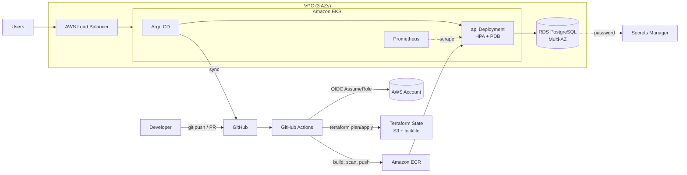
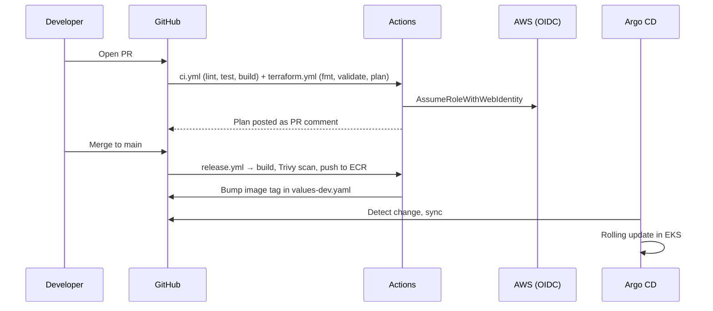

# ☁️ Cloud Platform Blueprint

> A production-grade, end-to-end **AWS cloud engineering reference platform** — Infrastructure as Code, Kubernetes, GitOps, CI/CD, observability, security and policy-as-code, all in one repository.

[](../../actions/workflows/ci.yml)
[](../../actions/workflows/terraform.yml)
[](../../actions/workflows/security.yml)


---

## 📌 What this repository demonstrates

| Area | Implementation |
|---|---|
| **Infrastructure as Code** | Terraform ≥ 1.10 with reusable modules (VPC, EKS, RDS, ECR), per-environment stacks, S3 native state locking |
| **Networking** | Multi-AZ VPC, public/private/database subnets, NAT gateways, VPC Flow Logs, S3 gateway endpoint |
| **Compute** | Amazon EKS with managed node groups, EKS Pod Identity, KMS envelope encryption of secrets, API-based access entries |
| **Data** | Amazon RDS PostgreSQL (Multi-AZ in prod), encryption at rest, password managed by AWS Secrets Manager |
| **Containers** | FastAPI microservice, multi-stage distroless-style Dockerfile, non-root, read-only root FS |
| **Kubernetes** | Hardened Helm chart: HPA, PDB, NetworkPolicy, probes, securityContext, topology spread |
| **GitOps** | Argo CD `Application` manifests (app-of-apps) per environment |
| **CI/CD** | GitHub Actions with **OIDC → AWS** (no long-lived keys), plan-on-PR / apply-on-merge, image build → scan → push |
| **Security** | Trivy, Checkov, tfsec-style checks, Gitleaks, Dependabot, OPA/Conftest policies for K8s manifests |
| **Observability** | Prometheus metrics endpoint, ServiceMonitor, alert rules (SLO burn-rate), Grafana dashboard |
| **Operations** | Runbooks, architecture decision records (ADRs), cost notes, Makefile developer workflow |

---

## 🏗️ Architecture



More detail: [`docs/architecture.md`](docs/architecture.md)

---

## 📁 Repository layout

```
.
├── app/                         # FastAPI microservice (source, tests, Dockerfile)
├── infra/terraform/
│   ├── bootstrap/               # One-time: state bucket + GitHub OIDC role
│   ├── modules/
│   │   ├── vpc/                 # Multi-AZ VPC, NAT, flow logs, endpoints
│   │   ├── eks/                 # EKS cluster, node groups, add-ons, KMS
│   │   ├── rds/                 # PostgreSQL with Secrets Manager password
│   │   └── ecr/                 # Container registry + lifecycle policy
│   └── envs/
│       ├── dev/                 # Dev environment composition
│       └── prod/                # Prod environment composition
├── k8s/
│   ├── charts/api/              # Hardened Helm chart for the service
│   └── platform/                # Cluster add-on values (ingress, monitoring)
├── gitops/argocd/               # Argo CD app-of-apps definitions
├── observability/               # Alert rules + Grafana dashboards
├── policies/conftest/           # OPA/Rego policies for Kubernetes manifests
├── scripts/                     # Helper scripts (bootstrap, local dev)
├── docs/                        # Architecture, runbooks, ADRs, security, cost
└── .github/                     # Workflows, Dependabot, templates, CODEOWNERS
```

---

## 🚀 Quick start

### Prerequisites

| Tool | Version |
|---|---|
| Terraform | ≥ 1.10 (or OpenTofu ≥ 1.8) |
| AWS CLI | v2 |
| kubectl | matching your EKS version |
| Helm | ≥ 3.14 |
| Docker | ≥ 24 |
| Python | ≥ 3.12 (for the app) |

### 1. Run the app locally

```bash
make app-install     # create venv + install deps
make app-test        # run unit tests
make app-run         # http://localhost:8080/docs
# or with Docker
make docker-build && make docker-run
```

### 2. Bootstrap AWS (once per account)

```bash
cd infra/terraform/bootstrap
cp terraform.tfvars.example terraform.tfvars   # set github_org / github_repo
terraform init && terraform apply
```

This creates the encrypted, versioned **Terraform state bucket** and an **IAM role that GitHub Actions assumes via OIDC**. Copy the outputs into your GitHub repository:

| GitHub setting | Value |
|---|---|
| Secret `AWS_ROLE_ARN` | `github_actions_role_arn` output |
| Variable `AWS_REGION` | e.g. `eu-west-1` |
| Variable `TF_STATE_BUCKET` | `state_bucket_name` output |

### 3. Deploy an environment

```bash
make tf-init ENV=dev
make tf-plan ENV=dev
make tf-apply ENV=dev
aws eks update-kubeconfig --name cpb-dev --region eu-west-1
```

### 4. Install platform add-ons & GitOps

```bash
./scripts/install-platform.sh dev
kubectl apply -f gitops/argocd/root-app-dev.yaml
```

Argo CD now continuously reconciles the `api` Helm chart from this repository.

---

## 🔄 CI/CD flow



| Workflow | Trigger | Purpose |
|---|---|---|
| `ci.yml` | PR, push | Lint (ruff), tests (pytest), Helm lint, Conftest policy check, Docker build |
| `terraform.yml` | PR/push on `infra/**` | fmt, validate, TFLint, plan (PR comment), apply on `main` with environment approval |
| `security.yml` | PR, weekly | Trivy (fs + IaC), Checkov, Gitleaks secret scan → GitHub code scanning |
| `release.yml` | push to `main` on `app/**` | Build & push image to ECR with SHA tag, scan, update GitOps values |

---

## 🔐 Security highlights

- **Zero static cloud credentials** — GitHub Actions uses OIDC federation with a repo/branch-scoped trust policy.
- **Encryption everywhere** — KMS for EKS secrets, S3 SSE, RDS storage encryption, TLS at the edge.
- **Least privilege** — EKS Pod Identity per workload, private API endpoint option, private subnets for nodes & DB.
- **Supply chain** — immutable ECR tags, scan-on-push, Trivy gate in CI, Dependabot for actions/pip/docker/terraform.
- **Policy-as-code** — Conftest blocks privileged containers, `:latest` tags, missing limits, missing probes.
- **Pod hardening** — non-root UID, read-only root filesystem, dropped capabilities, `RuntimeDefault` seccomp.

See [`docs/security.md`](docs/security.md).

---

## 💰 Cost awareness

The `dev` environment is tuned for low cost (single NAT gateway, SPOT nodes, `db.t4g.micro`, single-AZ DB). The `prod` environment uses NAT per AZ, on-demand nodes and Multi-AZ RDS. Estimates and levers: [`docs/cost.md`](docs/cost.md).

> ⚠️ **Running `terraform apply` creates billable AWS resources.** Always run `make tf-destroy ENV=dev` when you are done experimenting.

---

## 🧰 Make targets

```bash
make help
```

| Target | Description |
|---|---|
| `app-install` / `app-test` / `app-run` | Local Python workflow |
| `docker-build` / `docker-run` | Container workflow |
| `tf-fmt` / `tf-validate` / `tf-plan` / `tf-apply` / `tf-destroy` | Terraform per `ENV` |
| `helm-lint` / `helm-template` | Chart checks |
| `policy-test` | Run Conftest policies against rendered manifests |
| `pre-commit` | Run all pre-commit hooks |

---

## 📚 Documentation

- [Architecture](docs/architecture.md)
- [Runbook](docs/runbook.md)
- [Security](docs/security.md)
- [Cost](docs/cost.md)
- [ADRs](docs/adr/)
- [Contributing](CONTRIBUTING.md)

---

## 📝 License

MIT — see [LICENSE](LICENSE).
